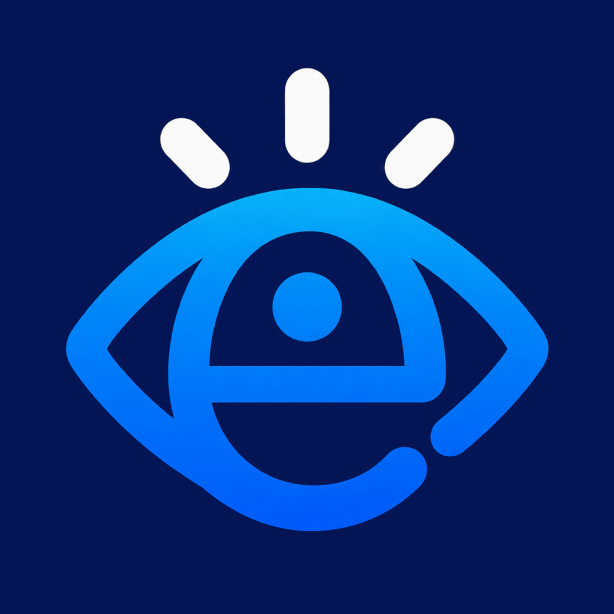

<p align="center">
  
</p>

<h1 align="center">EduExpose</h1>

<p align="center">
  Natywny klient <strong>eduVULCAN</strong> dla iPhone'a.<br>
  SwiftUI · Swift 6 · iOS 26 · Liquid Glass
</p>

<p align="center">
  <a href="https://github.com/Iwo24pl/EduExpose/actions/workflows/ios-ci.yml"></a>
  <a href="https://github.com/Iwo24pl/EduExpose/releases/latest"></a>
  <a href="https://github.com/Iwo24pl/EduExpose/releases"></a>
  <a href="https://github.com/Iwo24pl/EduExpose/blob/swift/LICENSE"></a>
  
</p>

## O projekcie

EduExpose to nieoficjalny, natywny klient dziennika **eduVULCAN** dla iPhone'a.
Zamiast przeglądarki dostajesz aplikację SwiftUI, która łączy się bezpośrednio
z API eduVULCAN (Prometheus) oraz VULCAN Hebe CE — bez własnego backendu,
bez pośredników i bez analityki.

Projekt jest kontynuacją **Dzienniczka Szpontniczek** (Kotlin/Compose).
Katalog `composeApp/` pozostaje w repozytorium jako implementacja referencyjna,
a wersja na iOS jest w całości napisana w Swift 6. Numer najnowszego stabilnego
wydania aktualizuje się automatycznie w badge'u **wersja** u góry.

## Funkcje

**Konta i logowanie**

- eduVULCAN przez Prometheus, w tym captcha proof-of-work i obsługa zgód,
- rejestracja urządzenia Hebe CE i podpisywanie każdego żądania RSA,
- wielu uczniów i szkół, przełączanie aktywnego konta,
- zapamiętana sesja w Keychain.

**Dziennik**

- Start: oceny, szczęśliwy numer i nadchodzące sprawdziany,
- Oceny: średnie, filtrowanie po okresie i szczegóły oceny,
- Plan lekcji z zastępstwami i nawigacją po tygodniach,
- Sprawdziany, zadania domowe, notatki/uwagi i ogłoszenia.

**Wiadomości**

- skrzynki Odebrane, Wysłane i Kosz,
- książka adresowa szkoły: nauczyciele, rodzice/opiekunowie i uczniowie,
- wybór skrzynki nadawcy („Od:”) i wyszukiwanie odbiorców,
- wysyłanie, odpowiedź, odpowiedź wszystkim i przekazywanie,
- usuwanie: najpierw do kosza, a z kosza trwale (z potwierdzeniem),
- podgląd załączników otrzymanych wiadomości.

**Interfejs**

- ciemny, granatowy motyw spójny z ikoną aplikacji,
- Liquid Glass na iOS 26, iPhone w orientacji pionowej,
- sprawdzanie aktualizacji przez GitHub Releases.

## Wymagania

**Do korzystania z aplikacji**

- iPhone z iOS **26.0** lub nowszym,
- darmowe Apple ID (płatne konto deweloperskie nie jest wymagane),
- komputer z Windows, macOS lub Linuxem — do pierwszej instalacji, a przy
  wariancie iLoader również do ponownego podpisania co 7 dni,
- Wi-Fi oraz [LocalDevVPN](https://apps.apple.com/app/localdevvpn/id6755608044),
  jeśli chcesz odświeżać aplikację na urządzeniu przez SideStore.

**Do budowania ze źródeł**

- macOS z **Xcode 26** (najnowszy stabilny),
- [XcodeGen](https://github.com/yonaskolb/XcodeGen),
- opcjonalnie iPhone z iOS 26 do uruchomienia na prawdziwym urządzeniu.

## Instalacja na iPhonie

Aplikacja nie jest dostępna w App Store. Każdy zielony build gałęzi `swift`
trafia jako **niepodpisane IPA** do wydania
[`latest`](https://github.com/Iwo24pl/EduExpose/releases/tag/latest).
Podpisujesz je swoim Apple ID.

Rekomendowany sposób to **iLoader** na komputerze, opcjonalnie połączony
z **SideStore** na iPhonie (odświeżanie bez komputera). Pełna instrukcja,
łącznie z weryfikacją SHA-256 i rozwiązywaniem typowych błędów:
**[docs/sideloading.md](docs/sideloading.md)**.

W skrócie:

1. Pobierz `EduExpose-unsigned.ipa` z wydania `latest` albo z wybranego
   wydania wersjonowanego.
2. Podłącz iPhone'a i podpisz IPA w iLoaderze swoim Apple ID (2FA).
3. Na iPhonie zaufaj certyfikatowi dewelopera i włącz Tryb dewelopera.
4. Uruchom EduExpose.

Darmowe Apple ID podpisuje aplikację na **7 dni**. SideStore potrafi ją
odświeżać w tle, gdy LocalDevVPN jest włączony.

## Pobieranie i weryfikacja

| Kanał | Tag | Zawartość |
| --- | --- | --- |
| Rolling | [`latest`](https://github.com/Iwo24pl/EduExpose/releases/tag/latest) | IPA + SHA-256 z każdego zielonego builda `swift` |
| Wydanie | tag `v*` | IPA + SHA-256 + dSYMy |

Każde wydanie zawiera plik `EduExpose-unsigned.ipa.sha256`. Sprawdź plik przed
podpisaniem:

```bash
# macOS / Linux
shasum -a 256 EduExpose-unsigned.ipa
```

```powershell
# Windows
Get-FileHash -Algorithm SHA256 .\EduExpose-unsigned.ipa
```

Wynik musi być identyczny z plikiem `.sha256` lub opisem wydania.

## Budowanie ze źródeł

Projekt Xcode jest generowany przez XcodeGen i **nie jest commitowany**
(`EduExpose.xcodeproj/` jest w `.gitignore`).

```bash
brew install xcodegen
xcodegen generate
open EduExpose.xcodeproj
```

Budowanie bez otwierania Xcode:

```bash
xcodegen generate
xcodebuild -project EduExpose.xcodeproj -scheme EduExpose \
  -destination 'platform=iOS Simulator,name=iPhone 17' \
  CODE_SIGNING_ALLOWED=NO build
```

Uruchomienie na iPhonie: wybierz swój zespół w *Signing & Capabilities*.
Jeśli identyfikator `com.iwo24pl.eduexpose` jest już zajęty na Twoim koncie,
zmień `PRODUCT_BUNDLE_IDENTIFIER` w `project.yml` i wygeneruj projekt ponownie.

## Testy

Testy używają frameworka **Swift Testing** i działają na symulatorze
(`iPhone 17` to przykład — wybierz model dostępny w Twoim Xcode):

```bash
xcodegen generate
xcodebuild -project EduExpose.xcodeproj -scheme EduExpose \
  -destination 'platform=iOS Simulator,name=iPhone 17' \
  CODE_SIGNING_ALLOWED=NO test
```

Zakres testów: parsery HTML/WS-Fed, logowanie, modele API, książka adresowa,
wiadomości, kolory marki i metadane sesji.

## Struktura repozytorium

```text
EduExpose/
  App/            punkt wejścia, AppModel, nawigacja
  API/            Prometheus, Hebe, RSA, poczta i modele
  DesignSystem/   paleta, Liquid Glass, komponenty
  Features/       ekrany: Start, Oceny, Plan, Sprawdziany, Wiadomości…
EduExposeTests/   testy jednostkowe (Swift Testing)
project.yml       specyfikacja XcodeGen
docs/             protokoły, instrukcje i roadmapa
```

`composeApp/`, `iosApp/`, `gradle*` i `build.gradle.kts` to historyczny klient
Kotlin/Compose, zachowany jako referencja. CI buduje wyłącznie aplikację Swift
z katalogu `EduExpose/`.

## CI i wydania

- **[iOS CI](https://github.com/Iwo24pl/EduExpose/actions/workflows/ios-ci.yml)** —
  push i pull request do `swift`: generowanie projektu, weryfikacja ikony,
  build, testy, smoke launch w symulatorze, publikacja niepodpisanego IPA
  w wydaniu `latest` oraz artefaktów z logiem i wynikami testów.
- **[Release IPA](https://github.com/Iwo24pl/EduExpose/actions/workflows/ios-release.yml)** —
  tag `v*` lub ręczne uruchomienie: IPA, SHA-256 i dSYMy w wydaniu.

Buildy `latest` są oznaczone jako prerelease. Stabilne wydania publikuj tagiem
`vX.Y.Z`; numer wersji aplikacji ustawia `MARKETING_VERSION` w `project.yml`.

## Dokumentacja

| Dokument | Zawartość |
| --- | --- |
| [docs/getting-started.md](docs/getting-started.md) | pierwsze kroki i konfiguracja konta |
| [docs/basic-usage.md](docs/basic-usage.md) | przykłady użycia API (implementacja referencyjna) |
| [docs/eduvulcan-login-flow.md](docs/eduvulcan-login-flow.md) | logowanie Prometheus, `/api/ap`, zgody, captcha |
| [docs/prometheus-login-helper.md](docs/prometheus-login-helper.md) | helper logowania Prometheus |
| [docs/login-and-hebece-client.md](docs/login-and-hebece-client.md) | rejestracja i podpisywanie Hebe CE |
| [docs/eduvulcan-mail-api.md](docs/eduvulcan-mail-api.md) | endpointy nowego API wiadomości |
| [docs/sideloading.md](docs/sideloading.md) | instalacja przez iLoader i SideStore |
| [docs/roadmap.md](docs/roadmap.md) | status, etapy i decyzje projektowe |

## Prywatność i bezpieczeństwo

- Aplikacja łączy się **bezpośrednio** z serwerami VULCAN/eduVULCAN. Nie ma
  własnego backendu, telemetrii ani reklam.
- Login, hasło i dane sesji są przechowywane na urządzeniu (Keychain oraz
  magazyn ciasteczek systemu). Nie są wysyłane nigdzie poza VULCAN.
- Diagnostyka poczty (`Ustawienia → Diagnostyka`) pokazuje adresy, statusy
  i nazwy ciasteczek, ale **nie** hasła ani wartości tokenów. Dziennik możesz
  skopiować i dołączyć do zgłoszenia błędu.
- Problemy bezpieczeństwa zgłaszaj prywatnie przez GitHub (profil właściciela
  repozytorium), a nie w publicznym issue.

## Znane ograniczenia

- brak wysyłania załączników (otrzymane można otworzyć),
- konta Hebe (starsze jednostki) mają pocztę tylko do odczytu,
- brak powiadomień push (wymagają płatnego konta deweloperskiego i uprawnień),
- darmowe Apple ID: podpis wygasa po 7 dniach, limit 3 aplikacji i 10 App ID
  tygodniowo (SideStore odświeża aplikację automatycznie),
- wyłącznie iOS 26+ i iPhone w orientacji pionowej,
- nieoficjalne API eduVULCAN może się zmienić bez ostrzeżenia.

## Status prawny

Projekt **nie jest powiązany** z VULCAN ani eduVULCAN. Nazwy eduVULCAN,
Dziennik VULCAN i Hebe należą do ich właścicieli. Aplikacja korzysta z tych
samych endpointów co oficjalny klient, więc korzystasz z niej na własną
odpowiedzialność i zgodnie z regulaminem szkoły oraz platformy.

## Licencja

[MIT](LICENSE) · Copyright (c) 2026 szpl2508sa.

Projekt jest kontynuacją Dzienniczka Szpontniczek (licencja MIT) i zachowuje
jego historię oraz notice w pliku `LICENSE`.
